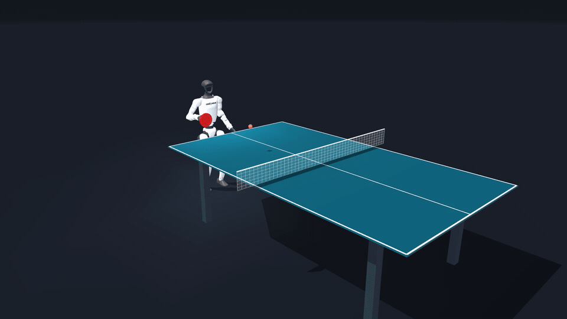

<h1 align="center">G1 Ping Pong Lab</h1>
<p align="center"><strong>Unitree G1 returns controlled feeds in MuJoCo.</strong></p>
<p align="center">A reproducible Unitree G1 table-tennis demo.</p>
<p align="center">
  <a href="LICENSE">Apache-2.0</a> ·
  <a href="https://github.com/MakazhanAlpamys/G1-Ping-Pong-Lab">GitHub</a> ·
  <a href="docs/quickstart.md">Quick start</a> ·
  <a href="docs/how-it-works.md">How it works</a> ·
  <a href="docs/results.md">Results & limitations</a>
</p>

<p align="center">
  <a href="media/demo.mp4"></a>
</p>
<p align="center">
  <a href="media/demo.mp4">Watch the original six-second demo</a> ·
  <a href="media/poster.png">View the poster</a>
</p>

The robot returns automatically scheduled, controlled feeds using a scripted arm
stroke over a pretrained whole-body balance controller. MuJoCo simulates the
robot, racket and ball. The wall is removed from the physical scene.

The verified session contains **two consecutive returns**. The robot and controller
keep running between feeds; only the ball is replaced for the next feed. This is
a controlled simulation demo with source code, recorded simulation states and a
physical validation report. The original video is an uncut six-second view at
normal speed. General tennis play, a continuous rally and transfer to real
hardware remain future work.

## What's inside

- Portable G1 scene, robot meshes and a pinned pretrained balance policy.
- CPU simulation and ONNX inference; no training GPU needed to run the demo.
- Automatic feeds, event-based scoring and full-session native stance audits.
- The original uncut demo, its animated preview, poster and render receipt.
- Offscreen rendering tools for generating videos locally.
- Recorded simulation states, validation results and third-party license provenance.

## Run it

Tested with Python 3.12 on Ubuntu / WSL. Run commands from the repository root.

```bash
python3.12 -m venv .venv
source .venv/bin/activate
python -m pip install -e ".[test]"
python -m pytest -q
python -m g1_ping_pong_lab.continuous_feeds --feeds 2 --interval 3 --tail 12 --output outputs/continuous-demo
```

On Windows PowerShell, activate with `.\.venv\Scripts\Activate.ps1` instead.
For the native replay and the full video rebuild, see [the quick start](docs/quickstart.md).

The verified recording is included for immediate replay:

```bash
g1-ping-pong-replay --session data/continuous-session.npz --active-seconds 12
```

## The stack

| Layer | Tool | Role |
| --- | --- | --- |
| Physics | MuJoCo 3.11.0 | Rigid-body dynamics and real contact events |
| Balance | Pretrained WBC + ONNX Runtime | Whole-body joint control |
| Stroke | NumPy, CEM-optimized parameters | A fixed right-arm reference trajectory |
| Validation | Native CPU substep audit | Return sequence, stance and actuator limits |
| Footage | MuJoCo offscreen renderer + FFmpeg | Exact saved states and moving cameras |

The demo runs locally on CPU. The ball state comes directly from the simulator. Camera perception and real-robot
localization are outside this release.

The supplied state recording includes the full 15-second stance observation.
Longer continuous tests achieved two legal returns out of four feeds. Separately,
eight identical trials with full resets produced eight returns. See
[results and limitations](docs/results.md) for the distinction; this release does
not establish a sustained rally.

## Project layout

```text
assets/       G1 scene, meshes, pretrained WBC and its configuration
src/          Controller, simulation, scoring and replay
tools/        Offscreen footage renderer
media/        Original six-second demo, preview, poster and render receipt
tests/        Controller, scoring and replay-selection checks
docs/         Quick start, architecture, results and publishing guide
data/         Verified recorded states for immediate replay
licenses/     Upstream notices and asset provenance
```

## License & credits

Project code, documentation, stroke parameters and recorded simulation states are
licensed under **Apache-2.0**. The pretrained WBC and mjlab-derived robot description
retain their Apache-2.0 notices; Unitree robot meshes retain **BSD-3-Clause**.
See [third-party notices](THIRD_PARTY_NOTICES.md) for pinned sources, hashes and
attribution. This is an independent project, unaffiliated with Unitree or the WBC authors.
